<div align="center">



# 🌐 Awesome Peer-to-Peer (P2P) Networking & Distributed Data Systems 🚀

[](https://awesome.re)
<a href="https://github.com/ishandutta2007/Awesome-Awesome-Awesome"></a><a href="https://discord.gg/jc4xtF58Ve"></a>
[](https://github.com/ishandutta2007/Awesome-Peer-To-Peer-Networking-Distributed-Data)
[](https://creativecommons.org/publicdomain/zero/1.0/)
[](https://github.com/ishandutta2007/Awesome-Peer-To-Peer-Networking-Distributed-Data/blob/main/README.md#-how-to-contribute)
[](#-sector-overview--market-dynamics)
<a href="https://github.com/ishandutta2007"></a>

<p align="center">
  <strong>A curated directory of production-ready SaaS platforms, enterprise solutions, and open-source GitHub projects for Peer-to-Peer (P2P) networking stacks, decentralized cloud storage, content-addressed data systems, and local-first data sync engines.</strong>
</p>

</div>

---

## 📑 Table of Contents

- [📊 Sector Overview & Market Dynamics](#-sector-overview--market-dynamics)
- [☁️ SaaS & Hosted Enterprise Platforms](#️-saas--hosted-enterprise-platforms)
- [💻 Open-Source GitHub Projects](#-open-source-github-projects)
  - [⭐ Top Open-Source P2P & Distributed Data Repositories](#-top-open-source-p2p--distributed-data-repositories)
  - [🏗️ Ecosystem Architectural Frameworks](#️-ecosystem-architectural-frameworks)
- [🧩 Key Architectural Concepts](#-key-architectural-concepts)
- [📈 Star History](#-star-history)
- [💖 Support & Sponsorship](#-support--sponsorship)
- [🤝 How to Contribute](#-how-to-contribute)
- [🛡️ Disclaimer & Security Considerations](#️-disclaimer--security-considerations)

---

## 📊 Sector Overview & Market Dynamics

The global decentralized cloud storage and distributed data infrastructure market is valued at approximately **$2.8 billion to $3.5 billion in 2025–2026** and is projected to exceed **$8.8 billion by 2030**, advancing at a Compound Annual Growth Rate (CAGR) of **21% to 25.9%**. 

The sector is **moderately fragmented**: underlying core protocols (such as BitTorrent, IPFS/libp2p, and WireGuard) demonstrate strong network-effect consolidation around battle-tested standards, while the commercial SaaS, enterprise file replication, and DePIN pinning gateway layers remain highly competitive with specialized multi-cloud, privacy-first, and web3 niche providers preventing single-vendor lock-in.

---

## ☁️ SaaS & Hosted Enterprise Platforms

Enterprise and developer platforms offering turnkey hosted IPFS gateways, decentralized S3-compatible cloud storage, continuous file synchronization, and decentralized delivery networks. Sorted by company scale (market capitalization / valuation / funding descending).

| Platform | Valuation / Company Scale | Starting Pricing | Free Tier / Free Trial Limits | Key Specialization & Core Capabilities |
| :--- | :--- | :--- | :--- | :--- |
| **[BitTorrent / BTFS](https://bittorrent.com)** | **~$295M FDV** (~$290M MCap / TRON Ecosystem) | **$19.95/yr** (Pro ad-free desktop) or token micro-billing for BTFS | **Free tier included**: Unlimited free torrent downloads; BTFS decentralized network participation | BitTorrent File System (BTFS) decentralized storage network, high-volume P2P content dissemination, and torrent acceleration. |
| **[Filecoin Cloud / Lighthouse](https://filecoin.io)** | **~$460M MCap** ($257M+ raised by Protocol Labs) | **$12.00/mo** (Lighthouse Lite Plan: 500 GB storage) | **5 GB free storage forever** (Hot IPFS gateway + persistent Filecoin storage proofs) | Cryptographic proof-of-spacetime decentralized storage marketplace, decentralized preservation, and verifiable datasets. |
| **[Pinata](https://pinata.cloud)** | **~$100M Valuation** ($21.5M funding raised) | **$20.00/mo** (Picnic Plan: 1 TB storage, 500 GB bandwidth, 3 seats) | **1 GB free storage forever** (10 GB monthly gateway bandwidth, 500 files, 1 dedicated gateway) | Production IPFS pinning service, ultra-fast global dedicated IPFS CDN gateways, image optimization, and Web3 asset hosting. |
| **[Fleek](https://fleek.xyz)** | **~$75M FDV / $35M Funding** (Decentralized edge network) | **$20.00/mo** (Fan/Pro tier: 1 TB bandwidth & global edge delivery) | **Free tier included**: 1 custom domain, baseline IPFS hosting, and community edge CDN access | Decentralized edge hosting, serverless edge compute, and automated IPFS/Filecoin CI/CD deployments for web apps. |
| **[Sia Network](https://sia.tech)** | **~$30M–$35M FDV** (~$30M MCap / Sia Foundation) | **~$2.00/TB/mo** (Contract-based renter fee on decentralized network) | **No direct hosted free plan** (Discord faucet grants free testing storage contracts to builders) | Trustless, blockchain-enforced smart contract storage renting with S3-compatible APIs via the official `renterd` daemon. |
| **[Resilio](https://resilio.com)** | **~$10M ARR / Acquired by Nasuni** ($9M funding prior) | **$7,500.00/yr** (Enterprise Resilio Active Everywhere) | **14-day free trial** with full enterprise features (custom multi-agent evaluation deployment) | High-throughput peer-to-peer enterprise file replication, real-time edge sync, and WAN acceleration based on the BitTorrent protocol. |
| **[Storj](https://storj.io)** | **~$5.5M MCap** ($30M+ funding raised) | **$4.00/TB/mo** storage + $0.007/GB egress ($7/TB bandwidth) | **30-day free trial**: 25 GB storage + 2 free Object Mount licenses (No credit card required) | Globally distributed, zero-knowledge encrypted S3-compatible object storage sharded across thousands of independent nodes. |
| **[Ethereum Swarm](https://ethswarm.org)** | **~$5.7M MCap** (BZZ native utility token) | **~$1.50/GB postage batch** (On-chain Swarm postage stamps) | **Free local testing network**; public gateway testnet tokens via Swarm Discord/faucet | Decentralized node storage, peer-to-peer data streaming, and censorship-resistant messaging native to the Ethereum ecosystem. |
| **[Filebase](https://filebase.com)** | **~$3.01M Seed Funding** (Multicoin Capital backed) | **$7.50/mo** (Pro Plan: 500 GB pooled storage, 250 GB IPFS egress) | **5 GB free pooled storage forever** (10 GB monthly IPFS bandwidth, 1 bucket, 500 pinned files) | Unified S3-compatible API abstracting IPFS, Storj, and Sia with geo-redundant multi-region automatic replication. |
| **[Crust Network](https://crust.network)** | **~$100K MCap** (Substrate / Polkadot DePIN ecosystem) | **~$0.50/TB/mo equivalent** (Dynamic DSM storage market in CRU) | **Free storage quota via Discord**: claim trial storage allocation in `#free-storage` channel | Incentivized IPFS storage network backed by Trusted Execution Environment (TEE) storage proofs and cross-chain EVM connectors. |

---

## 💻 Open-Source GitHub Projects

Explore the most popular open-source peer-to-peer networking libraries, decentralized filesystems, zero-trust mesh networks, and real-time collaboration engines. **Sorted by GitHub star count (descending)**.

### ⭐ Top Open-Source P2P & Distributed Data Repositories

- **[Syncthing](https://github.com/syncthing/syncthing)** [](https://github.com/syncthing/syncthing/stargazers)  
  Continuous, open-source peer-to-peer file synchronization program written in Go featuring end-to-end TLS encryption, block-level delta sync, and zero central servers.

- **[qBittorrent](https://github.com/qbittorrent/qBittorrent)** [](https://github.com/qbittorrent/qBittorrent/stargazers)  
  Cross-platform open-source C++ BitTorrent client supporting DHT, PEX, uTP, magnet links, sequential streaming, and an extensible web UI.

- **[Croc](https://github.com/schollz/croc)** [](https://github.com/schollz/croc/stargazers)  
  Fast, secure CLI tool written in Go enabling end-to-end encrypted, PAKE-authenticated peer-to-peer file and folder transfers across NATs.

- **[Tailscale](https://github.com/tailscale/tailscale)** [](https://github.com/tailscale/tailscale/stargazers)  
  Mesh peer-to-peer WireGuard-based overlay network client and daemon for direct encrypted communication between nodes and distributed infrastructure.

- **[WebTorrent](https://github.com/webtorrent/webtorrent)** [](https://github.com/webtorrent/webtorrent/stargazers)  
  Streaming open-source BitTorrent client for Node.js and web browsers powered by WebRTC data channels for serverless browser-to-browser file transfer.

- **[NetBird](https://github.com/netbirdio/netbird)** [](https://github.com/netbirdio/netbird/stargazers)  
  Open-source zero-trust peer-to-peer mesh overlay networking platform based on WireGuard for interconnecting infrastructure, servers, and devices.

- **[Magic Wormhole](https://github.com/magic-wormhole/magic-wormhole)** [](https://github.com/magic-wormhole/magic-wormhole/stargazers)  
  Open-source Python utility and protocol for securely transferring arbitrary files and short text between computers using human-pronounceable one-time codes.

- **[Yjs](https://github.com/yjs/yjs)** [](https://github.com/yjs/yjs/stargazers)  
  High-performance Conflict-Free Replicated Data Type (CRDT) engine enabling real-time local-first collaboration and state sync over P2P transports (WebRTC, WebSocket).

- **[ZeroNetX / ZeroNet](https://github.com/HelloZeroNet/ZeroNet)** [](https://github.com/HelloZeroNet/ZeroNet/stargazers)  
  Open-source decentralized peer-to-peer web platform utilizing Bitcoin cryptography and the BitTorrent network to host censorship-resistant websites.

- **[IPFS Kubo (go-ipfs)](https://github.com/ipfs/kubo)** [](https://github.com/ipfs/kubo/stargazers)  
  The reference open-source InterPlanetary File System (IPFS) daemon in Go for running content-addressed P2P nodes, Bitswap data exchange, and local HTTP gateways.

- **[Transmission](https://github.com/transmission/transmission)** [](https://github.com/transmission/transmission/stargazers)  
  Fast, lightweight, and versatile open-source cross-platform BitTorrent client with daemon, web client, and native GUI implementations.

- **[coturn](https://github.com/coturn/coturn)** [](https://github.com/coturn/coturn/stargazers)  
  Free open-source high-performance implementation of TURN and STUN server essential for VoIP and WebRTC peer-to-peer NAT traversal and media relay.

- **[Tinode](https://github.com/tinode/chat)** [](https://github.com/tinode/chat/stargazers)  
  Open-source instant messaging server and client suite built on gRPC/WebSockets with support for federated and distributed peer communication.

- **[n0-computer/iroh](https://github.com/n0-computer/iroh)** [](https://github.com/n0-computer/iroh/stargazers)  
  Modern, ultra-fast open-source P2P networking library written in Rust providing direct QUIC connections, automatic NAT hole-punching, and BLAKE3 verified byte streaming.

- **[Matrix Synapse](https://github.com/matrix-org/synapse)** [](https://github.com/matrix-org/synapse/stargazers)  
  Open-source reference homeserver for Matrix, an open network for secure, decentralized, and federated real-time communication.

- **[Berty](https://github.com/berty/berty)** [](https://github.com/berty/berty/stargazers)  
  Secure, peer-to-peer offline-first messaging protocol and app built atop libp2p, IPFS, and BLE (Bluetooth Low Energy) with zero centralized dependencies.

- **[OrbitDB](https://github.com/orbitdb/orbitdb)** [](https://github.com/orbitdb/orbitdb/stargazers)  
  Serverless, distributed, peer-to-peer database for the decentralized web using IPFS for data storage and IPFS Pubsub for automatic multi-master synchronization.

- **[OnionShare](https://github.com/onionshare/onionshare)** [](https://github.com/onionshare/onionshare/stargazers)  
  Open-source tool that lets you securely and anonymously share files, host websites, and chat with friends using the Tor onion-routed network.

- **[go-libp2p](https://github.com/libp2p/go-libp2p)** [](https://github.com/libp2p/go-libp2p/stargazers)  
  Go implementation of the modular peer-to-peer networking stack powering IPFS, Filecoin, and Ethereum with multiplexed transports and DHT routing.

- **[Automerge](https://github.com/automerge/automerge)** [](https://github.com/automerge/automerge/stargazers)  
  Library of data structures for building local-first collaborative applications with automatic conflict resolution, CRDT synchronization, and binary compaction.

- **[IPFS Desktop](https://github.com/ipfs/ipfs-desktop)** [](https://github.com/ipfs/ipfs-desktop/stargazers)  
  Official open-source desktop application bundling an IPFS Kubo node, tray menu, file manager, and system-wide IPFS protocol handler for Windows, macOS, and Linux.

- **[anacrolix/torrent](https://github.com/anacrolix/torrent)** [](https://github.com/anacrolix/torrent/stargazers)  
  Full-featured BitTorrent client library and utility package in Go supporting DHT, magnet URIs, uTP, webseeds, and sequential streaming.

- **[libtorrent (Rasterbar)](https://github.com/arvidn/libtorrent)** [](https://github.com/arvidn/libtorrent/stargazers)  
  Feature-complete, high-performance C++ BitTorrent protocol library designed for resource efficiency and maximum throughput across platforms.

- **[rust-libp2p](https://github.com/libp2p/rust-libp2p)** [](https://github.com/libp2p/rust-libp2p/stargazers)  
  The Rust implementation of the libp2p modular networking stack supporting multihash, noise handshakes, Yamux multiplexing, and Kademlia DHT.

- **[Tribler](https://github.com/Tribler/tribler)** [](https://github.com/Tribler/tribler/stargazers)  
  Privacy-enhanced open-source BitTorrent client featuring an onion-routed proxy network, decentralized search, and resilient P2P content discovery.

- **[Status Mobile](https://github.com/status-im/status-mobile)** [](https://github.com/status-im/status-mobile/stargazers)  
  Open-source decentralized private messaging, Web3 browser, and non-custodial crypto wallet powered by the Waku peer-to-peer messaging protocol.

- **[Storj (Storage Node & Uplink)](https://github.com/storj/storj)** [](https://github.com/storj/storj/stargazers)  
  Open-source distributed cloud object storage software powering Storj storage operators, satellite coordination, and erasure-coded client uplinks.

- **[Lotus (Filecoin)](https://github.com/filecoin-project/lotus)** [](https://github.com/filecoin-project/lotus/stargazers)  
  Official open-source Go implementation of the Filecoin distributed storage network protocol, Lotus daemon, and miner/storage provider node.

- **[js-libp2p](https://github.com/libp2p/js-libp2p)** [](https://github.com/libp2p/js-libp2p/stargazers)  
  Modular JavaScript and TypeScript implementation of libp2p running natively in modern browsers, Node.js, and Deno runtimes.

- **[Peergos](https://github.com/Peergos/Peergos)** [](https://github.com/Peergos/Peergos/stargazers)  
  Self-hosted, quantum-resistant end-to-end encrypted P2P cloud storage, social, and workspace platform built on IPFS.

- **[IPFS Companion](https://github.com/ipfs/ipfs-companion)** [](https://github.com/ipfs/ipfs-companion/stargazers)  
  Browser extension that harnesses local or gateway IPFS nodes to automatically resolve ipfs://, ipns://, and content-addressed web pages.

- **[IPFS Cluster](https://github.com/ipfs-cluster/ipfs-cluster)** [](https://github.com/ipfs-cluster/ipfs-cluster/stargazers)  
  Pinset orchestration and cluster consensus daemon for replicating, balancing, and managing datasets across multiple IPFS Kubo nodes.

- **[Swarm Bee](https://github.com/ethersphere/bee)** [](https://github.com/ethersphere/bee/stargazers)  
  Open-source Go client for connecting to and participating in the Ethereum Swarm decentralized storage, communication, and messaging network.

- **[Holochain](https://github.com/holochain/holochain)** [](https://github.com/holochain/holochain/stargazers)  
  Energy-efficient, agent-centric distributed computing framework and P2P application engine written in Rust replacing blockchain with cryptographic validation.

- **[Mysterium Node](https://github.com/mysteriumnetwork/node)** [](https://github.com/mysteriumnetwork/node/stargazers)  
  Open-source node software powering the Mysterium distributed P2P VPN (dVPN) network enabling decentralized bandwidth sharing and encrypted traffic relaying.

- **[Helia](https://github.com/ipfs/helia)** [](https://github.com/ipfs/helia/stargazers)  
  Lean, modern open-source IPFS implementation written from scratch in TypeScript for browser environments, service workers, and modern Node.js applications.

- **[Earthstar](https://github.com/earthstar-project/earthstar)** [](https://github.com/earthstar-project/earthstar/stargazers)  
  Small, friendly decentralized database protocol for local-first peer-to-peer apps with multi-peer sync over HTTP, WebSockets, or file attachments.

- **[Holepunch Pear](https://github.com/holepunchto/pear)** [](https://github.com/holepunchto/pear/stargazers)  
  Open-source peer-to-peer runtime and application deployment CLI powered by the Hypercore protocol, bare JS runtime, and Hyperswarm DHT.

- **[Sia renterd & hostd](https://github.com/SiaFoundation/renterd)** [](https://github.com/SiaFoundation/renterd/stargazers)  
  Next-generation open-source Sia storage renter and host daemons written in Go with S3-compatible endpoints and autonomous contract management.

---

### 🏗️ Ecosystem Architectural Frameworks

```
                      +---------------------------------------+
                      |       Local-First Applications        |
                      |   (Real-time State / CRDT Sync)       |
                      +-------------------+-------------------+
                                          |
                        +-----------------+-----------------+
                        |                                   |
              [Yjs / Automerge CRDTs]            [OrbitDB / Earthstar]
                        |                                   |
                        +-----------------+-----------------+
                                          |
                      +-------------------+-------------------+
                      |   P2P Transport & Identity Layers     |
                      |   (QUIC / WebRTC / Noise Handshakes)  |
                      +-------------------+-------------------+
                                          |
            +-----------------------------+-----------------------------+
            |                             |                             |
      [iroh / QUIC]                [libp2p Stacks]             [Holepunch Hyperswarm]
            |                             |                             |
            +-----------------------------+-----------------------------+
                                          |
                      +-------------------+-------------------+
                      | Content-Addressed Storage & Exchange  |
                      | (Bitswap, BLAKE3, IPFS, BitTorrent)   |
                      +-------------------+-------------------+
                                          |
            +-----------------------------+-----------------------------+
            |                             |                             |
   [IPFS Kubo / Helia]             [qBittorrent / uTP]          [Syncthing Delta Sync]
            |                             |                             |
            +-----------------------------+-----------------------------+
                                          |
                      +-------------------+-------------------+
                      |   Decentralized Persistence & DePIN   |
                      |    (Verifiable Proof of Storage)      |
                      +-------------------+-------------------+
                                          |
            +-----------------------------+-----------------------------+
            |                             |                             |
    [Filecoin / Lotus]              [Storj DCS / S3]               [Sia renterd]
```

---

## 🧩 Key Architectural Concepts

| Concept | Description | Reference Implementations |
| :--- | :--- | :--- |
| **Content Addressing (CID)** | Locating data based on its cryptographic hash rather than host/IP location. | IPFS, IPLD, BLAKE3 Verified Bytes (`iroh`) |
| **NAT Traversal & Hole-Punching**| Establishing direct peer-to-peer UDP/TCP connections across asymmetric firewalls. | STUN/TURN (`coturn`), DERP relays, ICE, Hyperswarm |
| **Conflict-Free Replicated Data Types** | Data structures allowing concurrent offline edits with deterministic convergence. | `Yjs`, `Automerge`, `OrbitDB` |
| **Erasure Coding & Sharding** | Splitting data into $N$ fragments where only $M$ ($M < N$) are required to recover the file. | `Storj`, `Reed-Solomon`, `Kademlia` |
| **Decentralized Storage Proofs** | Zero-knowledge and cryptographic verifications (Proof of Spacetime, Proof of Replication) ensuring nodes host the data. | `Filecoin (Lotus)`, `Crust TEE`, `Sia` |

---

## 📈 Star History

## Star History

[](https://star-history.dera.page/#ishandutta2007/Awesome-Peer-To-Peer-Networking-Distributed-Data&type=date&legend=top-left)
[](https://www.star-history.com/#ishandutta2007/Awesome-Peer-To-Peer-Networking-Distributed-Data&type=date&legend=top-left)

---

## 💖 Support & Sponsorship

Thank you for exploring and utilizing the **Awesome Peer-to-Peer Networking & Distributed Data** directory! Maintaining, verifying, and expanding this ecosystem map is a continuous open-source labor of love.

If you find this repository valuable for your research, projects, or infrastructure, here is how you can support our efforts:

- ⭐ **Star this repository** to improve its visibility across the developer community.
- 🍴 **Fork and contribute** by submitting new P2P libraries, protocols, or SaaS updates via Pull Requests.
- 📢 **Share this list** on Twitter/X, LinkedIn, Reddit, Hacker News, or engineering Discord groups.
- ☕ **Buy us a coffee & sponsor our development**: Support ongoing curation and open-source tooling directly through the **[GitHub Sponsor Dashboard](https://github.com/sponsors/ishandutta2007)**!

[](https://github.com/sponsors/ishandutta2007)

---

## 🤝 How to Contribute

We welcome active contributions to keep this ecosystem directory accurate, up-to-date, and comprehensive!

1. **Fork the repository** on GitHub.
2. **Add or update an entry** in `README.md` keeping formatting consistent:
   - For SaaS: Name, link, company scale/valuation, starting tier price, and exact free tier/trial limit.
   - For Open-Source: Name, link, GitHub stars badge (`style=social&color=white`), and an informative 1–2 sentence description.
3. **Ensure factual descriptions** and link directly to official documentation or code repositories.
4. **Submit a Pull Request** with a clear explanation of your addition.

---

## 🛡️ Disclaimer & Security Considerations

- This repository is a **community-curated index** intended for research, engineering, and architectural evaluation.
- **Network Privacy**: Public DHT networks (such as BitTorrent Mainline DHT and IPFS Kademlia DHT) expose participant IP addresses by default unless wrapped in anonymity networks (e.g., Tor Onion Services, Veilid, or VPN relays).
- **Client-Side Encryption**: Always encrypt confidential files locally prior to pinning or replicating them across decentralized public storage networks.
- All trademarks, logos, and service marks belong to their respective owners.

---

<div align="center">

**Curated with ❤️ for distributed systems architects, local-first builders, and decentralization engineers.**  
*Star the repository if you find it helpful!*

</div>
